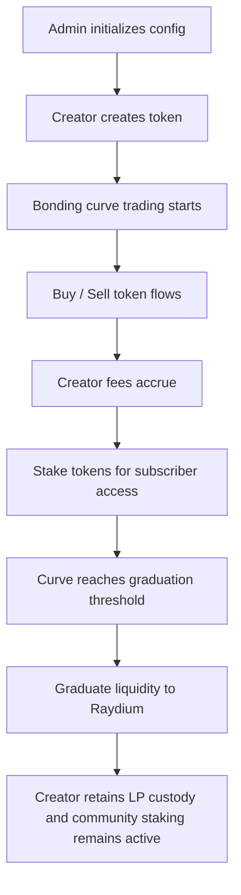

# Nozz.tv

Nozz.tv is a Solana Anchor program for creator-owned token economies. It lets creators mint their own token, launch it through an on-chain bonding curve, capture trading fees, and eventually graduate the liquidity into a DEX while also supporting staking-based subscriber access.

## Why this exists

Traditional creator platforms take a large cut of monetization and often delay payouts. Nozz.tv shifts that value flow on-chain so that:

- streamers and digital creators can launch a token tied to their audience and community
- fans can buy into the creator economy through a transparent bonding-curve market
- communities can stake to unlock subscriber perks, access, and reward tiers
- creators keep more of the value they generate instead of giving it to opaque platform systems

This is especially designed for streaming-first creator businesses, where loyalty, access, and community are the real product. The token becomes a way to align the creator, their audience, and the on-chain incentives around live content, perks, and community ownership.

## Program overview

The project is an Anchor-based Solana program that combines three core flows:

1. Platform configuration
2. Creator token launch and bonding-curve trading
3. Staking and DEX graduation

## High-level lifecycle



## Core modules

| Module         | Purpose                                                                           |
| -------------- | --------------------------------------------------------------------------------- |
| `constants`    | Global seed values, protocol constants, and fixed defaults                        |
| `error`        | Custom Anchor error codes and validation failures                                 |
| `events`       | Indexed event emission for trading, graduation, and staking state changes         |
| `instructions` | Instruction handlers for config, token launch, trading, and staking               |
| `state`        | On-chain account layouts for config, bonding curves, staking pools, and positions |
| `utils`        | Curve math and helper logic shared by instructions                                |

## Features

### 1. Platform config

The protocol is configured once at the singleton config PDA.

- `initialize_config` — creates the global platform config
- `update_config` — updates the protocol fee split and platform settings

### 2. Creator token launch

Creators can mint a Token-2022 asset with metadata and bootstrap it into a bonding curve.

- `create_token` — mints the token and initializes its bonding curve + staking pool
- `buy_token` — executes a buy against the virtual reserve curve
- `sell_token` — sells token back into the curve and pays out SOL
- `claim_fees` — allows creator withdrawal of earned fee lamports
- `graduate_to_dex` — migrates the remaining liquidity into Raydium once the curve is complete

### 3. Stake-to-subscribe model

A creator token can be staked to unlock access, subscriber status, and reward accrual. This is the streaming-native layer of the protocol: fans stake to gain access to premium creator benefits, early drops, subscriber perks, and reward distributions.

- `stake` — deposits tokens into the creator's staking pool
- `unstake` — removes stake and updates subscription status
- `claim_stake_rewards` — claims accumulated reward emissions
- `update_min_stake` — lets creator adjust membership threshold

### 4. Streaming-powered creator economy

The protocol is built around the idea that creators are not just artists or brands — they are communities. In a streaming context, this means:

- fans can participate in the creator economy instead of only passively watching
- subscription tiers can be represented through staking and token access
- rewards can be tied to creator activity, community engagement, and token utility
- the platform creates a bridge between live content, audience loyalty, and on-chain monetization

This keeps the original streaming vision alive while still matching the program’s actual on-chain mechanics.

## Repository structure

```text
├── Anchor.toml                    # Anchor workspace config
├── Cargo.toml                     # Rust workspace settings
├── README.md                      # Project docs + lifecycle overview
├── package.json                   # JS helpers / local tooling
├── programs/                      # Solana program source tree
│   └── nozz-launchpad/            # Main Anchor program crate
│       └── src/
│           ├── constants.rs       # Seed values and fixed protocol constants
│           ├── error.rs           # Custom Anchor errors
│           ├── events.rs          # Event emissions for trading/staking/graduation
│           ├── instructions/      # Program instruction handlers
│           │   ├── admin/         # Admin-only config actions
│           │   ├── creator/       # Creator-side launch actions
│           │   ├── user/          # User flows: buy, sell, stake, graduate
│           │   └── mod.rs         # Instruction registry
│           ├── lib.rs             # Program entrypoint and IDL exports
│           ├── state/             # On-chain account definitions
│           │   └── mod.rs
│           └── utils.rs           # Shared math / PDA / curve helpers
├── tests/                         # Anchor + Rust end-to-end tests
│   ├── src/                       # Test harness and scenario runners
│   └── Cargo.toml                 # Test crate dependencies
├── migrations/                    # Deployment migration scripts
```

## Tech stack

- Rust
- Anchor
- Solana
- Token-2022 + metadata extensions
- Raydium CPMM integration for DEX graduation

## Prerequisites

- [Rust](https://www.rust-lang.org/tools/install)
- [Solana CLI](https://docs.solana.com/cli/install-solana-cli-tools)
- [Anchor CLI](https://www.anchor-lang.com/docs/installation)
- Node.js 18+ (for the JS-based local tooling)

## Local development

### Install dependencies

```bash
pnpm install
```

### Build the program

```bash
anchor build
```

### Run the tests

```bash
anchor test
```

You can also run the Rust test target directly if needed:

```bash
cargo test -- --nocapture
```

### Deploy locally

```bash
anchor deploy --provider.cluster localnet
```

## Notes

- The protocol is designed around a creator-owned token launchpad model.
- Bonding-curve pricing is computed using virtual and real reserve accounting.
- After graduation, the curve is migrated into a DEX and liquidity is locked under the program-owned bonding-curve identity.
- Staking rewards are emitted from a dedicated allocation bucket and tied to the token lifecycle.

## License

MIT
